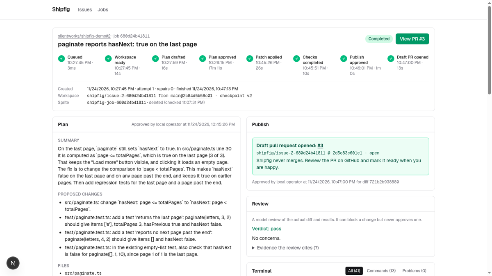

# Three-minute demo

This demo shows a real GitHub issue becoming a real draft PR. The run that
produced [silentworks/shipfig-demo#3](https://github.com/silentworks/shipfig-demo/pull/3)
spent about 80 seconds in automated steps:

| Step | Time |
| --- | --- |
| Workspace | 14 s |
| Plan | 16 s |
| Patch | 26 s |
| Checks | 10 s |
| Publish | 13 s |

The rest of the three minutes is for talking and clicking.



## Before you present

1. **Check the demo repo is ready.**
   * [silentworks/shipfig-demo](https://github.com/silentworks/shipfig-demo)
     issue #2 ("paginate reports hasNext: true on the last page") is open, and
     the bug is on `main`.
   * Close PRs from earlier rehearsals so the demo opens a fresh one. Shipfig
     never deletes branches, so do it yourself:

     ```bash
     gh pr list -R silentworks/shipfig-demo --state open
     gh pr close <number> -R silentworks/shipfig-demo --delete-branch
     ```

2. **Warm up.**
   * Open the app and sign in with the operator token.
   * Pick the demo repo once, so the gateway sprite is awake.
   * Make sure no job is active: the home page shows no banner.
3. **Prepare the fallback.**
   * Open [demo/walkthrough.mp4](demo/walkthrough.mp4) in a second tab.
   * Open the completed job page for the last good run in a third tab.

## Script

| Time | Say | Do |
| --- | --- | --- |
| 0:00 | Maintainers drown in small, well-defined issues. An agent can fix them, but nobody should merge agent code they can't verify. | Show the issue on GitHub. |
| 0:30 | Shipfig only works on allowlisted repos. Pick the issue. | **Issues** → choose the repo → select #2 → **Run Shipfig**. |
| 0:50 | Every job gets its own Fly.io Sprite. It can only reach GitHub and npm, has no credentials and can't use `sudo`. Claude reads the real code and proposes a plan. | Point at the timeline (Workspace ready, then Plan drafted) and the Plan panel. |
| 1:20 | Nothing changes until I approve. Then Claude edits with narrow tools and **Shipfig** runs the checks itself, before and after. | **Approve plan**. Show Checks: 4 passing before, 6 after, typecheck green. |
| 2:00 | This is the exact diff. My approval is bound to its sha256, so if anything changed, publishing would be refused. | Scroll through the Diff, then **Approve and open draft PR**. |
| 2:30 | A real draft PR, written through a separate trusted gateway sprite. It carries the evidence, and Shipfig never merges. | Click **View PR**. Show the Verification table in the PR body. |

## If something fails live

* **The Sprites or model API is slow or down.** Switch to the walkthrough
  video. It is 54 seconds of real screens from the run that opened PR #3.
* **A step fails.** That's a feature: show the failed step in the timeline,
  the readable error and the preserved evidence, then click **Retry**. A
  failed publish resumes without redoing the work.
* **A PR for the branch already exists.** Shipfig reuses it instead of
  opening a duplicate.
